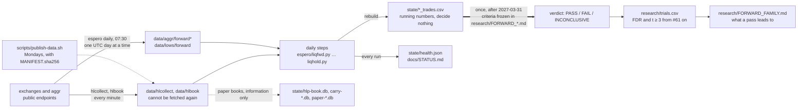

# How a recording becomes a verdict

The project's centre is fourteen forward tests on data that is being recorded now and judged once,
after 2027-03-31. Everything else (the backtests, the paper accounts, the measurements) exists to make
that judgment honest. This page is the path from a bar recorded tonight to a line in the ledger, and
the checklist for adding a new test, signal or finding without breaking the shape.



## The path, step by step

1. **Record.** Two loops run all the time: `espero hlcollect --loop` (Hyperliquid's top accounts, HLP,
   contexts, 1-minute candles) and `espero hlbook --loop` (the order book). They write only `data/`.
   Hyperliquid serves no history, so a slot not taken is gone; these folders are "class 4" in
   `.gitignore`: ignored, manifested, published weekly, never deleted.
2. **Fetch the day.** `espero daily` at 07:30 local saves yesterday's aggr liquidation bars and
   Binance's 5-minute files for 42 coins. aggr deletes its bars after days, so a day missed is a gap,
   recorded as missing, never filled from another source.
3. **Rebuild the ledgers.** Each forward step applies its frozen rule to everything recorded so far
   and rewrites one CSV in `state/`. `runner.PLANS` names the document each step serves. The numbers in
   those CSVs are for watching; the plans say they decide nothing.
4. **Paper books, beside the ledgers.** #12's carry books, #58/#59's HLP books and the BTC paper loop
   hold simulated positions from the same recordings. They are information only; no verdict reads them.
5. **Judge once.** After 2027-03-31, each `research/FORWARD_*.md` is applied as written: its criteria,
   its halves, its not-one-coin check, its cost bar. The verdict is written to `RESULTS_*.md` and a row
   of `research/trials.csv`. Running numbers before that date are never a result.
6. **Count it against everything else.** From #61 on, a pass needs Benjamini-Hochberg q < 0.05 over the
   whole ledger and |t| ≥ 3, both ([FDR_STANDARD.md](../research/FDR_STANDARD.md)). A pass that pays
   leads where [FORWARD_FAMILY.md](../research/FORWARD_FAMILY.md) says, and nowhere else.

What is deliberately **not** on the path: a mainnet order. The only signing code is the Hyperliquid
testnet mirror for #12's maker book. A real order is the account holder's act, outside this repo.

## Where a thing lives

| thing | where | held by |
|---|---|---|
| a rule | `espero/<name>.py`, pure, one per test | `espero/layers.py` ("rules"), `tests/test_<name>.py` |
| its contract and verdict | `research/PREREGISTRATION_<NAME>.md`, `RESULTS_<NAME>.md` | `research/index.py` |
| its script, run log, events | `research/<name>.py`, `<name>_run.txt`, `<name>_events.*` | `research/index.py` |
| a forward plan | `research/FORWARD_<NAME>.md` | `runner.PLANS`, `tests/test_shape.py` |
| its daily step | `espero/<name>fwd.py` or similar, called from `runner.run_daily` | `runner.PLANS` |
| its ledger | `state/<name>_trades.csv` | `.gitignore` (never in git) |
| a paper book | `state/<name>.db` | the lock in `espero/lock.py`; the installer's guard |
| a recording | `data/<folder>/` | `.gitignore` class 4, `MANIFEST.sha256`, `publish-data.sh` |
| the ledger of tests | `research/trials.csv` | `espero/trials.py`, `research/fdr_rescore.py` |
| the current state of everything | `docs/STATUS.md` | `scripts/status.py` (generated) |

## Adding a test, a signal or a finding

The structure is a set of tables that CI checks, so a new piece has one place to go in each, and the
build fails until it is there. The scaffold writes the files and prints the rest:

```bash
.venv/bin/python scripts/new-test.py 61 depthday            # a historical test
.venv/bin/python scripts/new-test.py 62 funding_lag --forward   # a forward test with a daily step
```

Then, in order:

1. **Write the pre-registration** the scaffold created, and commit it **before** computing anything.
   Hypothesis, data, rule, criteria (FDR and t ≥ 3 from #61 on), power, outcomes. A committed
   pre-registration is fixed; a later idea takes a new number.
2. **Fill the rule module** (pure: arrays in, numbers out) and its test. Break the rule and confirm
   the test fails (the mutation check), then restore it.
3. **Claim the files:** the module in `espero/layers.py`, the research files in `research/index.py`'s
   `TESTS` table. Regenerate with `python -m espero.layers` and `python research/index.py`.
4. **If it's forward:** add the step to `runner.run_daily` and its plan to `runner.PLANS`; add the
   ledger name to `scripts/move-state.sh`'s pattern if it isn't `*.csv`; the step records a day at a
   time and its ledger decides nothing.
5. **Run it once** (historical) or **let it run** (forward). Write `RESULTS_<NAME>.md` with the verdict
   as committed, including a FAIL, and add the row to `research/trials.csv`.
6. **Regenerate** `docs/STATUS.md` (`python scripts/status.py`) and run `./scripts/check.sh`.

A **finding that isn't a test** (an exploration, a mechanism memo, a measurement) still gets a document
in `research/` and a claim in `research/index.py`, under the test it serves or in a cross-cutting
group, and is labelled information only. Ideas not yet tested go in `research/IDEAS_NOVEL.md`.

A **new signal** is a new test. There is no path from "this looks good" to a book that skips the
numbered pre-registration, and the trials ledger is what makes the next test's bar honest.

## What CI holds

| check | fails when |
|---|---|
| `tests/test_layers.py` | a module in `espero/` is in no layer, or the README's layout block is stale |
| `tests/test_research_index.py` | a file in `research/` is unclaimed, or `INDEX.md` is stale |
| `tests/test_shape.py` | a state file sits at the repo root, a daily step has no plan, a module has no test |
| `tests/test_manifest.py` | a recorded folder is missing from `.gitignore`, the publish list or the fetch list |
| `tests/test_reference.py` and the `*_reference` tests | a published number no longer reproduces from the committed data |
| every `tests/test_<rule>.py` | the frozen rule's behaviour changes |
