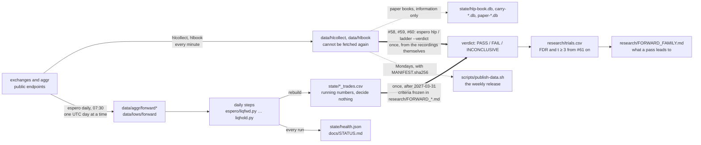
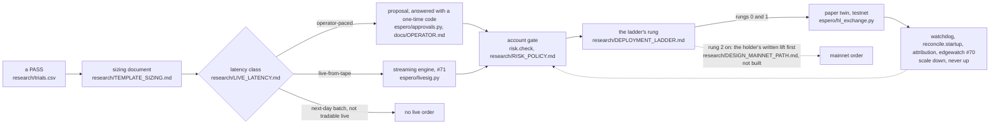

# How a recording becomes a verdict

The project's centre is fourteen forward tests on data that is being recorded now and judged once,
after 2027-03-31. Everything else (the backtests, the paper accounts, the measurements) exists to make
that judgment honest. This page is the path from a bar recorded tonight to a line in the ledger, and
the checklist for adding a new test, signal or finding without breaking the shape.



## The path, step by step

1. **Record.** Two loops run all the time: `espero hlcollect --loop` (Hyperliquid's top accounts, HLP,
   contexts, 1-minute candles) and `espero hlbook --loop` (the order book). They write only `data/`.
   Hyperliquid serves no history, so a slot not taken is gone; these folders are "class 4" in
   `.gitignore`: ignored, manifested, published weekly, never deleted.
2. **Fetch the day.** `espero daily` at 07:30 local saves yesterday's aggr liquidation bars and
   Binance's 5-minute files for 42 coins. aggr deletes its bars after days, so a day missed is a gap,
   recorded as missing, never filled from another source.
3. **Rebuild the ledgers.** Each forward step applies its frozen rule to the aggr bars and Binance
   files fetched so far and rewrites one CSV in `state/`. `runner.PLANS` names the document each step
   serves. The numbers in those CSVs are for watching; the plans say they decide nothing. The three
   Hyperliquid tests (#58, #59, #60) have no daily step: their verdicts are computed from the
   recordings themselves, once, by `espero hlp --verdict` and `espero ladder --verdict`.
4. **Paper books, beside the ledgers.** #12's carry books, #58/#59's HLP books and the BTC paper loop
   hold simulated positions from the same recordings. They are information only; no verdict reads them.
5. **Judge once.** After 2027-03-31, each `research/FORWARD_*.md` is applied as written: its criteria,
   its halves, its not-one-coin check, its cost bar, from the ledger CSV, or for #58–#60 from the
   recordings directly. The verdict is written to `RESULTS_*.md` and a row of `research/trials.csv`.
   Running numbers before that date are never a result.
6. **Count it against everything else.** From #61 on, a pass needs Benjamini-Hochberg q < 0.05 over the
   whole ledger and |t| ≥ 3, both ([FDR_STANDARD.md](../research/FDR_STANDARD.md)). A pass that pays
   leads where [FORWARD_FAMILY.md](../research/FORWARD_FAMILY.md) says, and nowhere else.

**Beside the path, from 2026-11-02:** `espero rawrec --loop` keeps the venues' raw websocket streams
(Binance, Bybit, OKX, Hyperliquid mainnet and testnet) in the folder named by `ESPERO_RAW_DIR`, never
`data/` (docs/DATA.md, section 5). Two measurements read that tape: #61 rebuilds aggr's bars from it and
reports how far they diverge, and #62 replays every paper and testnet fill on the recorded book. Both are
pre-registered with a tolerance and change no verdict. From #61 on every result also carries the robustness
block of `research/ROBUSTNESS_STANDARD.md` (deflated Sharpe, PBO, purged k-fold, half-life, turnover,
capacity), reported, not decisive; and #63 fixes, before any two passes exist, how passes would share one
account (`research/PREREGISTRATION_SLEEVES.md`).

What is deliberately **not** on the path: a mainnet order. The only signing code is the Hyperliquid
testnet mirror for #12's maker book. A real order is the account holder's act, outside this repo. The next
section is what stands between a verdict and that act.

## From a verdict to an order

A PASS is not an order. Every step between a verdict and a sized order is built and tested before any verdict
exists, on recorded tape and the testnet, so a pass changes numbers in documents, not code. None of it can place
a mainnet order; research/DESIGN_MAINNET_PATH.md describes the module that would, as a design only.



1. **The sizing document.** A pass leads, as research/FORWARD_FAMILY.md says, to a sizing-and-execution
   document written from research/TEMPLATE_SIZING.md: the verdict and its cluster, the latency class, the
   operator mode, the venue and its measured costs, #62's fill error, #63's weight, the readouts at size
   (research/ROBUSTNESS_LIVE.md), edgewatch's parameters, the caps, the ladder plan and the holder's sign-off.
2. **How late it may act.** research/LIVE_LATENCY.md gives each forward rule a budget (the document's own
   tolerance, else the entry delay plus 5 % of the hold) and derives its class from the feeds that exist
   (`espero/latency.py`, `classify`): *operator-paced* when a human has time (the feed plus four hours fits the
   budget), *live-from-tape* when only the machine reading the recorder's tape does, *next-day batch* when only
   the 07:30 run can, *not tradable live* when the event is not knowable at its decision time. Each row lists
   what still stands between a PASS and a live order. A new forward rule cannot be added without its row.
3. **Who decides.** An operator-paced rule goes through docs/OPERATOR.md: the machine proposes (rule, size from
   the gate, price, costs, stop, expiry), the operator answers with a one-time code (`espero approve`),
   silence means no entry, and an exit never waits for an answer. Every proposal and answer is an event in a
   hash-chained ledger (`espero/approvals.py`); what the overrides earn against the rule is #69. A
   live-from-tape rule is the streaming engine's (#71, `espero/livesig.py`): the operator watches, kills and
   answers alarms.
4. **The account gate.** Every order a venue would see passes `risk.check` (research/RISK_POLICY.md): the
   capital from docs/HOLDER_INPUTS.md (0 until the holder answers, so every order is refused today), leverage
   1, 20 % per coin, 50 % per venue, the distance to liquidation, the funding paid, the day and week stops, open
   breaks and the KILL and `.pause` files. Each ruling carries the policy's hash.
5. **The ladder.** research/DEPLOYMENT_LADDER.md, with `espero/rungs.py`: the paper twin from the day after the
   verdict, then the testnet (50 round trips, every fault below drilled), then a canary at the venue's minimum,
   then 10 % of the target, doubled after each clean block of 30 fills, up to the target the sizing document
   fixed. The canary needs the holder's committed lift of the no-mainnet rule; until then the ladder stops at
   the testnet.
6. **Watching it run.** `espero watchdog` alarms on silence (the recorders, the daily run, the loops, the
   disk, and the clock: past one second off, trading is refused); `reconcile.startup` sets the journal against
   the venue before the first order after any start; `espero/attribution.py` splits each sleeve's P&L into
   fees, funding and slippage against its paper twin and pauses entries on an equity break; from the canary,
   #70's edgewatch (`espero/edgewatch.py`) halves a sleeve whose edge has gone and flattens it on a second
   alarm. Nothing on this path raises size.
7. **Rehearsed first.** `espero/replay_stack.py` runs the path in miniature on recorded books with seven
   faults injected (dropped frames, a silent venue, a partial fill, a restart mid-order, an unknown position,
   clock skew, stale input), each held by a test; `espero replay-stack --day DAY` runs a recorded day's #71
   events through it.

What only the holder decides is in docs/HOLDER_INPUTS.md: the capital, the drawdown at which they stop, the
venues they may use, the hours for the operator role, the machine's autonomy for live-from-tape rules, and
whether to lift the no-mainnet rule, in their own words.

## Where a thing lives

| thing | where | held by |
|---|---|---|
| a rule | `espero/<name>.py`, pure, one per test | `espero/layers.py` ("rules"), `tests/test_<name>.py` |
| its contract and verdict | `research/PREREGISTRATION_<NAME>.md`, `RESULTS_<NAME>.md` | `research/index.py` |
| its script, run log, events | `research/<name>.py`, `<name>_run.txt`, `<name>_events.*` | `research/index.py` |
| a forward plan | `research/FORWARD_<NAME>.md` | `runner.PLANS`, `tests/test_shape.py` |
| its daily step | `espero/<name>fwd.py` or similar, called from `runner.run_daily` | `runner.PLANS` |
| its ledger | `state/<name>_trades.csv` | `.gitignore` (never in git) |
| a paper book | `state/<name>.db` | the lock in `espero/lock.py`; the installer's guard |
| a recording | `data/<folder>/` | `.gitignore` class 4, `MANIFEST.sha256`, `publish-data.sh` |
| the raw tape | `$ESPERO_RAW_DIR/<venue>/<day>/` | `espero rawrec`, `MANIFEST.sha256` per day; not in the release |
| the ledger of tests | `research/trials.csv` | `espero/trials.py`, `research/fdr_rescore.py` |
| the current state of everything | `docs/STATUS.md` | `scripts/status.py` (generated) |
| a step from a verdict to an order | `espero/<name>.py` in the `live` layer, its document in `docs/` or `research/` | `espero/layers.py` ("live"), `tests/test_<name>.py` |

## Adding a test, a signal or a finding

The structure is a set of tables that CI checks, so a new piece has one place to go in each, and the
build fails until it is there. The scaffold writes the files and prints the rest:

```bash
.venv/bin/python scripts/new-test.py 61 depthday            # a historical test
.venv/bin/python scripts/new-test.py 62 funding_lag --forward   # a forward test with a daily step
```

Then, in order:

1. **Write the pre-registration** the scaffold created, and commit it **before** computing anything.
   Hypothesis, data, rule, criteria (FDR and t ≥ 3 from #61 on), power, outcomes. A committed
   pre-registration is fixed; a later idea takes a new number.
2. **Fill the rule module** (pure: arrays in, numbers out) and its test. Break the rule and confirm
   the test fails (the mutation check), then restore it.
3. **Claim the files:** the module in `espero/layers.py`, the research files in `research/index.py`'s
   `TESTS` table. Regenerate with `python -m espero.layers` and `python research/index.py`.
4. **If it's forward:** add the step to `runner.run_daily` and its plan to `runner.PLANS`; add the
   ledger name to `scripts/move-state.sh`'s pattern if it isn't `*.csv`; the step records a day at a
   time and its ledger decides nothing.
5. **Run it once** (historical) or **let it run** (forward). Write `RESULTS_<NAME>.md` with the verdict
   as committed, including a FAIL, and add the row to `research/trials.csv`.
6. **Regenerate** `docs/STATUS.md` (`python scripts/status.py`) and run `./scripts/check.sh`.

A **finding that isn't a test** (an exploration, a mechanism memo, a measurement) still gets a document
in `research/` and a claim in `research/index.py`, under the test it serves or in a cross-cutting
group, and is labelled information only. Ideas not yet tested go in `research/IDEAS_NOVEL.md`.

A **new signal** is a new test. There is no path from "this looks good" to a book that skips the
numbered pre-registration, and the trials ledger is what makes the next test's bar honest.

## What CI holds

| check | fails when |
|---|---|
| `tests/test_layers.py` | a module in `espero/` is in no layer, or the README's layout block is stale |
| `tests/test_research_index.py` | a file in `research/` is unclaimed, or `INDEX.md` is stale |
| `tests/test_shape.py` | a state file sits at the repo root, a daily step has no plan, a module has no test |
| `tests/test_manifest.py` | a recorded folder is missing from `.gitignore`, the publish list or the fetch list |
| `tests/test_reference.py` and the `*_reference` tests | a published number no longer reproduces from the committed data |
| every `tests/test_<rule>.py` | the frozen rule's behaviour changes |
